  

  <b>Estudiante de Mecatrónica en ITLA</b> · Experto mecánico formado en Italia · Productor musical 
  Construyo hardware que suena y software que automatiza.

---

### 🎛️ Proyecto principal — en diseño

**Tarjeta de audio con pedales para guitarra y bajo**
Interfaz de audio pensada para estudios de producción, con efectos tipo pedal integrados, para implementarse en el estudio de sonido del ITLA. Es mi proyecto final de carrera: hardware analógico, procesamiento digital y diseño mecánico de la carcasa en un mismo sistema.

`🔜 Documentación y repositorio en camino`

---

### 🧩 Proyectos

<table>
<tr>
<td width="50%" valign="top">

**🎚️ LMS — Sistema de gestión de sello discográfico**
Plataforma para administrar artistas, catálogo de beats y proyectos de un sello independiente. Chat de composición asistido por IA con *fallback* entre proveedores (Claude, GPT-4o, Gemini), autenticación argon2id con control de acceso por roles y despliegue con Cloudflare Tunnel.

`Bun` `Node.js` `IA multi-proveedor` `RBAC`

</td>
<td width="50%" valign="top">

**🤖 Gestión de agentes de IA**
Sistema de colaboración entre agentes (Claude y Codex) mediante carpetas compartidas y protocolos de coordinación, orquestado con Claude Code para análisis de datos, marketing y programación.

`Claude Code` `Codex` `Multi-agente`

</td>
</tr>
<tr>
<td width="50%" valign="top">

**🎓 ITLA Scheduler**
Asistente académico que extrae tareas y módulos de Moodle con Playwright y envía reportes diarios por un bot de Telegram con botones interactivos, integrado con la API de Claude.

`Node.js` `Playwright` `Telegram Bot` `Claude API`

</td>
<td width="50%" valign="top">

**💬 Agente de ventas por WhatsApp**
Agente que responde mensajes de clientes de forma automática para una tienda en línea, construido en n8n con Evolution API y GPT-4o.

`n8n` `Evolution API` `GPT-4o` `WhatsApp`

</td>
</tr>
</table>

---

### 🛠️ Herramientas

**Electrónica y embebidos:** C · ESP32 / ESP-IDF · FreeRTOS · STM32 · Arduino · Verilog/FPGA · PLC · KiCad
**Diseño mecánico:** SolidWorks · AutoCAD · Torno y fresadora · CNC (G-code)
**Software y automatización:** Node.js · Bun · Playwright · n8n · APIs de IA

---

Santo Domingo, República Dominicana · Italia

